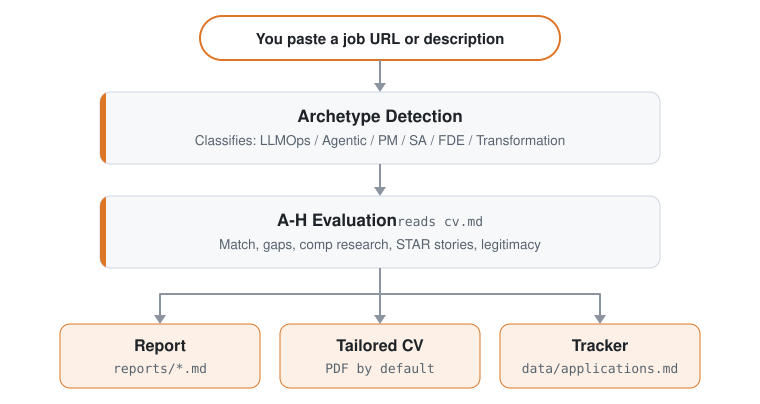
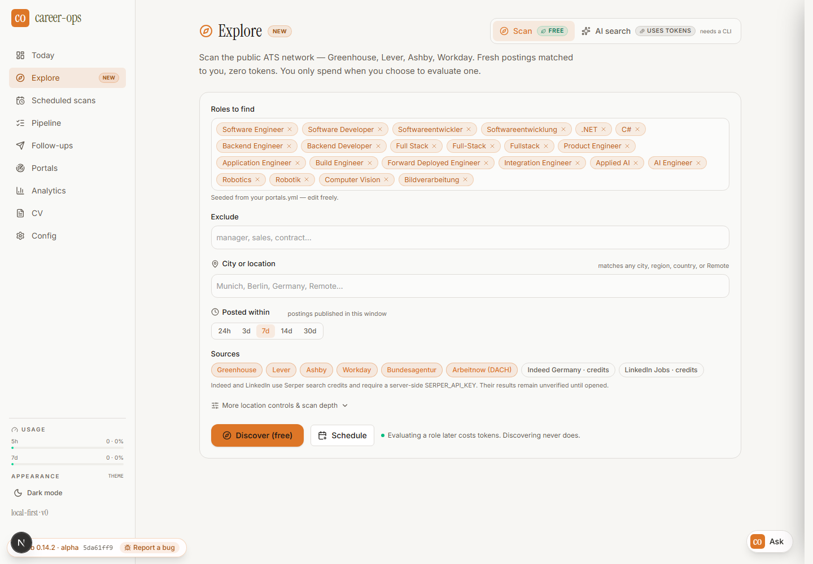

# Career-Ops Germany

An AI job-search workspace for the German market. Find roles, evaluate postings against your experience, draft tailored CVs, and track applications through your AI coding CLI or a local web app.

This community fork builds on [career-ops](https://github.com/career-ops-hq/career-ops), created by [Santiago Fernández de Valderrama (santifer)](https://santifer.io). Keep your career data in a separate private folder. You review drafts and submit applications yourself.

[New to AI?](#new-to-ai-start-here) · [Quick start](#quick-start) · [Private data setup](docs/PRIVATE_DATA_REPO.md) · [German-market guide](docs/GERMAN_MARKET.md) · [Web app](web/README.md)

## New to AI? Start here

You do not need to write code. An **AI coding assistant** is an app you can talk to in ordinary language that can also work with files on your computer. Career-Ops supplies the job-search instructions and tools; the assistant helps you set them up and use them.

Choose **Codex or Claude Code**, then follow the [beginner walkthrough: let AI help you set up](docs/BEGINNER_SETUP.md). It has separate getting-started instructions for both assistants, followed by shared setup prompts. Use the prompts in its chat box; commands such as `git clone` belong in a terminal, which the assistant can help you use.

Your first message can be:

> I am new to AI and technical setup. Help me install https://github.com/alireza7575/career-ops-germany for my own job search. First ask which operating system I use and where I want the files. Check what is already installed, explain each step in plain language, and handle the setup work you can. Keep my career data in a separate private folder. Do not ask for passwords or API keys in chat. Tell me clearly whenever I need to click something or sign in myself.

**Start with the walkthrough before sharing your CV.** It takes you through private data setup, adding your own experience, and evaluating one job. If you already use an AI coding assistant, continue with the quick start below.

## What this fork adds

| Area | German-market workflow |
| --- | --- |
| Discovery | A reusable German software-role portal preset, Bundesagentur and Arbeitnow in the web Explorer, and optional search-based discovery. |
| Evaluation | German-market modes, with market rules selected independently from the language of reports and drafts. |
| Personal data | A documented two-repository setup: public code and your own private CV, profile, tracker and reports. |
| Windows | Codex Desktop bundle detection and an optional Windows Task Scheduler worker for saved scans. |

The preset is a starting point. Personalize your roles, languages, location policy and salary targets before relying on recommendations.

## Quick start

### 1. Clone and install

You need Git, Node.js matching the engines in [package.json](package.json), and an AI coding CLI such as Codex or Claude Code.

```bash
git clone https://github.com/alireza7575/career-ops-germany.git
cd career-ops-germany
npm install --ignore-scripts
```

The upstream npm initializer installs the original project. Clone this repository to get this fork's additions.

### 2. Connect your private data folder

Follow the [complete private data repository guide](docs/PRIVATE_DATA_REPO.md) to create your **private** GitHub repository, configure ignore rules, and make your first push.

Use two sibling folders:

```text
career-workspace/
├── career-ops-germany/   # Code; run the CLI here
└── career-ops-data/      # Your private data repository
```

In the code folder, create a plain-text `.career-ops-data` file containing:

```text
../career-ops-data
```

This local marker is ignored by Git. Data-root environment variables override it; see the [guide](docs/PRIVATE_DATA_REPO.md#4-connect-the-code-to-your-data-folder) if you have an existing setup.

### 3. Onboard with your own CV

Open your AI coding CLI in `career-ops-germany` and ask:

> Run career-ops onboarding using the data root in .career-ops-data. Help me add my own CV, target roles, languages, location policy and salary targets. For this new setup, use templates/portals.germany.example.yml as portals.yml and set language.modes_dir to modes/de. Ask which output language I want. Keep personal data in the data root and preserve existing files.

Then check setup from the code folder:

```bash
node doctor.mjs --json --cli codex
```

Use your CLI's name if different. Resolve missing or unpersonalized profile entries before scanning. For an existing `portals.yml`, merge the desired preset entries instead of replacing your configuration.

### 4. Run your first scan

Ask your agent:

> Run career-ops scan mode for the enabled API boards and configured web searches. Screen results against my profile and report sources you could not scan. Keep uncertain matches pending.

For browser installation and PDF dependencies, see [the full setup guide](docs/SETUP.md).

## Choose your language

Merge this into `config/profile.yml` in your **data folder**:

```yaml
language:
  modes_dir: modes/de
  output: en
```

`modes/de` selects German-market evaluation rules. Set `output: de` for German reports and drafts, or keep `en` for English. This setting does not translate the web interface. Preserve other settings in an existing `language` section.

Optional [German screening rules](templates/custom.germany.example.md) belong in your data folder's `modes/_custom.md`. Personal targeting belongs in `config/profile.yml` and `modes/_profile.md`.

For Codex interactive and headless usage, see [docs/CODEX.md](docs/CODEX.md). You can also run `codex exec "Run career-ops scan mode"` from the code folder; ordinary-language prompts work without slash commands.

The core features and command reference below come from upstream career-ops. Use the fork setup above for this repository.

## Features

| Feature                  | Description                                                                                                                              |
| ------------------------ | ---------------------------------------------------------------------------------------------------------------------------------------- |
| **A-H Evaluation**       | Role summary, CV match (with how much each requirement matters for this posting, and whether that weight came from the JD's own wording, its structure, or an estimate, labelled per requirement; an estimate can never be top-band), level strategy, comp research, personalization, interview prep (STAR+R) -- plus a Block G posting-legitimacy check (is it still open, is it a repost: observations, not verdicts), and a Work-Auth signal that flags an explicit no-sponsorship JD as a hard blocker |
| **Human-in-the-Loop**    | AI evaluates and recommends, you decide and act. The system never submits an application -- you always have the final call <!-- hitl: absolute guarantee. Do not add "automatically", "by itself", "without your permission" or any other hedge when translating this row. -->               |
| **ATS PDF Generation**   | ATS-readable CVs tailored to each JD from your own experience, in Space Grotesk + DM Sans design                                                                                 |
| **Cover Letter Generator** | Research-backed cover letters with keyword mirroring, four interactive angle prompts (why/problems/approach/tone), draft-in-chat approval gate, and A4 PDF via the same HTML + Playwright pipeline as CVs. Auto-drafts on every evaluation; complete and generate on demand via `/career-ops cover` |
| **Beyond the CV**        | Company research ([`deep`](modes/deep.md)) surfaces AI strategy, recent moves, engineering culture, and the angle your profile should take. Contact discovery ([`contacto`](modes/contacto.md)) identifies the hiring manager, recruiter, or team peer worth reaching out to and drafts a ≤300-character LinkedIn message tuned to each contact type. Formal application email drafts ([`email`](modes/email.md)) turn an evaluated report or pasted JD into a subject line, body, and attachment checklist without sending, submitting, or clicking anything. Applications get you in the queue; research gets you a conversation. |
| **Pattern Analysis**     | Rejection patterns and per-ATS-channel advance rates (`analyze-patterns.mjs`), lifetime funnel stats (`stats.mjs`), repost detection, a possible sign of a ghost job (`detect-reposts.mjs`) |

<details>
<summary><b>Everything else it does</b></summary>

| Feature                  | Description                                                                                                                              |
| ------------------------ | ---------------------------------------------------------------------------------------------------------------------------------------- |
| **Auto-Pipeline**        | Paste a URL, get a full evaluation + PDF + tracker entry                                                                                 |
| **Interview Story Bank** | Accumulates STAR+Reflection stories across evaluations -- 5-10 master stories you can adapt to the behavioral questions you get                        |
| **Negotiation Scripts**  | Salary negotiation frameworks, geographic discount pushback, competing offer leverage                                                    |
| **Application Email Drafts** | Formal recruiter/referral/cold application emails from a report or pasted JD, with subject line, attachment checklist, source-backed fit points, and a profile-driven contact block. Draft-only -- career-ops never sends, submits, or clicks anything. |
| **Portal Scanner**       | 100+ companies pre-configured (Anthropic, OpenAI, ElevenLabs, Retool, n8n...) + custom web-search queries across Ashby, Greenhouse, Lever, Wellfound |
| **Funded Company Discovery** | Review-first `npm run company:funded` script surfaces recently funded companies and source diagnostics from structured public feeds without editing your data |
| **Batch Processing**     | Parallel evaluation with headless CLI workers (`claude -p` / `opencode run`)                                                             |
| **Dashboard TUI**        | Terminal UI to browse, filter, and sort your pipeline                                                                                    |
| **Pipeline Integrity**   | Automated merge, dedup, status normalization, health checks                                                                              |
| **Interview Suite**      | Time-blocked prep plans, practice sessions with feedback, post-interview debriefs ([`interview/`](modes/interview/README.md)), and a company red-flag detector ([`interview-redflag`](modes/interview-redflag.md)) |
| **Offer Stage**          | Contract reading companion -- clause walk plus a lawyer question list ([`offer-prep`](modes/offer-prep.md)) -- and a desired/advertised/actual salary-gap analyzer (`salary-gap.mjs`) |
| **Follow-ups & Replies** | Follow-up cadence calculator and seeded reminders (`followup-cadence.mjs`, `followup-seed.mjs`); turn them off with `follow_ups.enabled: false` in `config/profile.yml`; employer reply classification into tracker updates ([`reply-watch`](modes/reply-watch.md)) |
| **Plugin System**        | Opt-in integrations (Gmail, Notion, Apify + a community registry), disabled by default -- see [docs/PLUGINS.md](docs/PLUGINS.md)        |
| **LinkedIn job alerts**  | Paste a LinkedIn alert email on the dashboard or with `node linkedin-import.mjs`. No Google account. See [docs/LINKEDIN_JOBS.md](docs/LINKEDIN_JOBS.md) |

</details>

## How It Works

<p align="center"><picture><source media="(prefers-color-scheme: dark)" srcset="docs/how-it-works-dark.svg"></picture></p>

## Usage

Paste a job URL or description into your AI CLI. career-ops checks that a linked posting is still live (pasted text has no link to check), scores it against your CV, writes a report, tailors your CV (a PDF by default) and adds a row to your tracker. That covers most days. Everything else is a mode you ask for by name. If a posting can't be read, the pipeline stops and asks you to paste the text or share a screenshot.

### Asking for a mode

| CLI | How you ask for `scan` |
| --- | --- |
| Claude Code, OpenCode, Antigravity CLI (`agy`), Grok Build CLI | `/career-ops scan` |
| Pi | `/skill:career-ops scan` |
| Codex, Qwen, Cursor, or any other supported CLI | Plain language: "Run the career-ops scan mode" |

`/career-ops` with nothing after it shows the command menu in the CLIs that use it. Plain language works in every supported CLI. As a Claude Code plugin, the command is `/career-ops:career-ops`.

All of them share one router, `.agents/skills/career-ops/SKILL.md`, and the same `modes/*.md` files, so every CLI routes a request the same way (browser-heavy modes also need Playwright tools). Slash commands are not guaranteed in Codex: ask in plain language, or run one prompt headless with `codex exec "Evaluate this JD with career-ops auto-pipeline: https://company.com/jobs/123"` ([docs/CODEX.md](docs/CODEX.md)). How to run it in each supported CLI, headless commands where a CLI has one, and per-CLI setup notes are in [docs/SUPPORTED_CLIS.md](docs/SUPPORTED_CLIS.md).

### The everyday commands

| Command | What it does |
| --- | --- |
| *paste a URL or JD* | Full pipeline: liveness check (URLs only), A-G evaluation plus H at high scores, report, tailored CV (PDF by default), tracker row |
| `scan` | Scan your portals for new postings and add them to the inbox (`data/pipeline.md`) |
| `pipeline` | Work through the URLs waiting in the inbox (the standard and premium tiers may skip obvious mismatches) |
| `apply` | Fill an application form with you, field by field. It stops before Submit |
| `tracker` | Where every application stands |
| `followup` | Which applications are due a follow-up, with drafts |

<details>
<summary><b>All commands, by stage of the search</b></summary>

`oferta`, `ofertas` and `contacto` keep their original Spanish names: offer, offers, contact.

**Find roles**

| Command | What it does |
| --- | --- |
| [`scan`](modes/scan.md) | Scan portals and discover new offers |
| [`discover`](modes/discover.md) | Resolve a list of company names to scannable ATS boards. Previews by default; adds them to `portals.yml` only with `--write` (zero-token) |
| [`pipeline`](modes/pipeline.md) | Process pending URLs from the inbox (`data/pipeline.md`) |
| [`triage`](modes/triage.md) | Fast first-pass go/no-go score from `modes/_brief.md`, before a full evaluation (writes no files) |
| [`batch`](modes/batch.md) | Evaluate many postings with headless workers (parallel with Claude, one at a time with other CLIs) |
| [`titles`](modes/titles.md) | Suggest adjacent job titles from your CV to broaden the search |

**Evaluate a role**

| Command | What it does |
| --- | --- |
| *paste a URL or JD* | [Auto-pipeline](modes/auto-pipeline.md): evaluation + report + tailored CV (PDF by default) + tracker entry |
| [`oferta`](modes/oferta.md) | Evaluation only, Blocks A to G plus H at high scores (no PDF) |
| [`ofertas`](modes/ofertas.md) | Compare and rank several offers |
| [`deep`](modes/deep.md) | Deep research prompt about the company |
| [`eu-swe`](modes/regional/eu-swe.md) | Calibrate a European software-engineering application before CV, apply or interview |

**Apply**

| Command | What it does |
| --- | --- |
| [`pdf`](modes/pdf.md) | ATS-optimized CV as a PDF |
| [`ats`](modes/ats.md) | ATS-friendliness check of a generated CV: score and fixable issues |
| [`text`](modes/text.md) | Tailored CV as markdown (mirrors `cv.md`, no PDF) |
| [`latex`](modes/latex.md) | Export the CV as LaTeX/Overleaf `.tex` |
| [`latex-tex`](modes/latex-tex.md) | Tailor your own `resume.tex` in place (opt-in; `cv.md` stays the default) |
| [`cover`](modes/cover.md) | Cover letter, from a pasted JD or an evaluated report (`cover {slug}`) |
| [`email`](modes/email.md) | Formal application email draft. Draft-only: never sends, submits or clicks |
| [`contacto`](modes/contacto.md) | Find the hiring manager, recruiter or a peer, and draft a LinkedIn message |
| [`apply`](modes/apply.md) | Live application assistant (Playwright from this checkout). Does not submit |

**Interview**

| Command | What it does |
| --- | --- |
| [`interview-prep`](modes/interview-prep.md) | Company-specific interview prep document |
| [`interview/plan`](modes/interview/plan.md) | Time-blocked prep plan for an upcoming interview |
| [`interview/practice`](modes/interview/practice.md) | Practice interview, one question at a time, with feedback |
| [`interview/debrief`](modes/interview/debrief.md) | Post-interview debrief: close gaps, predict the next round |
| [`interview-redflag`](modes/interview-redflag.md) | Analyze an employer's warning signs before you join |

**After you apply**

| Command | What it does |
| --- | --- |
| [`tracker`](modes/tracker.md) | Application status overview |
| [`followup`](modes/followup.md) | Follow-up cadence: flag overdue applications, generate drafts |
| [`reply-watch`](modes/reply-watch.md) | Classify employer replies and suggest tracker updates |
| [`outcome`](modes/outcome.md) | Record an application's outcome and archive its artifacts |
| [`offer-prep`](modes/offer-prep.md) | Read a received offer or contract with you: clause walk and questions for a lawyer (not legal advice) |

**Your profile and CV**

| Command | What it does |
| --- | --- |
| [`interview`](modes/interview.md) | Profile setup: an interactive interview about your experience that builds your CV and profile (not interview practice) |
| [`intake`](modes/intake.md) | Build or enrich your profile from files in `documents/` (master CV, LinkedIn export). Nothing is written without your confirmation |
| [`master-profile`](modes/master-profile.md) | Import, review and validate your Master Career Profile, and prepare selected facts as CV bullets |
| [`add`](modes/add.md) | Add a project, paper or role to your CV (fetch, preview, confirm) |
| [`expand`](modes/expand.md) | Discover competencies missing from your CV, from your profile links |
| [`retro`](modes/retro.md) | Review this session and keep what you taught it as rules (writes only the ones you accept) |

**Improve your targeting**

| Command | What it does |
| --- | --- |
| [`patterns`](modes/patterns.md) | Analyze rejection patterns and improve targeting |
| [`calibrate`](modes/calibrate.md) | Check whether your evaluation scores predict your real outcomes. Advisory: never changes scoring |
| [`upskill`](modes/upskill.md) | Skill-gap analysis across your evaluated reports |
| [`training`](modes/training.md) | Evaluate a course or certification against your North Star |
| [`project`](modes/project.md) | Evaluate a portfolio project idea |

**System**

| Command | What it does |
| --- | --- |
| [`agent-inbox`](modes/agent-inbox.md) | Queue requests for the next session, and work through them then (`data/agent-inbox.md`). `inbox` works too |
| [`update`](modes/update.md) | Update career-ops system files, with a diff preview and compatibility check |

</details>

## Project Structure

```
career-workspace/
├── career-ops-germany/          # Public code checkout
│   ├── AGENTS.md                # Agent instructions
│   ├── .career-ops-data         # Local path to the private data folder (gitignored)
│   ├── modes/
│   │   ├── _shared.md           # Shared context (system file; local edit kept unless apply --force)
│   │   └── _profile.md          # Your archetypes and framing (customize this in the data folder)
│   ├── templates/               # Starter configuration and CV templates
│   ├── providers/               # Job board integrations
│   └── web/                     # Optional local web app
└── career-ops-data/             # Your private repository: CV, profile, portals, tracker, reports
```

## Daily use

Run your agent from the code folder. It reads and writes career files in the configured data folder.

| Task | Example prompt |
| --- | --- |
| Find jobs | Run career-ops scan mode using my German-market portals and profile. Report incomplete coverage. |
| Evaluate a job | Evaluate this job with career-ops auto-pipeline: `<job URL>`. Verify location, working arrangement and language requirements. |
| Tailor a CV | Run career-ops PDF mode for my latest evaluated role, using only facts supported by my approved source files. |

Read each evaluation and generated application before sending it. Save career-data changes in the private repository and code changes in this repository. The [private data guide](docs/PRIVATE_DATA_REPO.md#daily-use) covers syncing between computers.

## Optional local web app

```bash
cd web
npm ci
npm run dev
```

Open [localhost:3000](http://localhost:3000). The app provides Pipeline, Explore, CV, Config and analytics views. It binds to loopback by default. See [web/README.md](web/README.md) for requirements, data-root overrides and scheduled scans.



*Explorer from this fork with demo settings. No personal career data is shown.*

## Limits and review

- Search hits are leads. Verify that the employer's posting is live and matches your location, working arrangement, language and hiring-eligibility requirements.
- API-board scans and agent-led web searches are separate. Missing credentials or inaccessible sources mean incomplete coverage.
- CVs and application drafts must use your approved facts. Review them for accuracy before sending.
- Assisted application flows leave submission to you. You review the form and press Submit.
- Files stay in your local workspace, but the AI provider and optional search services you choose receive the data needed for their requests. A private GitHub data repository also uploads the files you commit there.

## Updates and troubleshooting

This is a maintained fork. Follow [the fork update instructions](docs/GERMAN_MARKET.md#receive-upstream-updates): merge upstream changes into your code checkout, resolve conflicts, run checks, and push your tested branch. The system updater can replace system files or preserve customized files, leaving a mixed installation; do not assume a version label proves compatibility.

Keep your personal data repository separate and back it up. Its ignore rules are independent of this code repository's rules.

| Problem | Next step |
| --- | --- |
| Setup reports missing files | Run `node doctor.mjs --json --cli codex` from the code folder and finish onboarding. |
| Files appear in the wrong folder | Check `.career-ops-data`, `CAREER_OPS_ROOT`, `CAREER_OPS_DATA_DIR`, and any web environment overrides. Check `CAREER_OPS_TRACKER` for tracker-specific overrides. |
| Search results do not fit | Personalize `portals.yml`, your location policy and language requirements; verify the full posting. |
| Some sources are missing | Check source configuration and credentials. Optional Indeed/LinkedIn search discovery needs `SERPER_API_KEY`; keep it out of Git. |
| PDF or browser startup fails | Follow [the setup guide](docs/SETUP.md) for browser dependencies. |
| CI fails after an update | Inspect failures before merging; preserved fork code and newer upstream contracts may need reconciliation. |

More help: [German-market guide](docs/GERMAN_MARKET.md) · [Private data troubleshooting](docs/PRIVATE_DATA_REPO.md#troubleshooting) · [Supported boards](docs/SUPPORTED_JOB_BOARDS.md) · [FAQ](docs/FAQ.md) · [Data contract](DATA_CONTRACT.md).

## You don't have to search alone

Find the original project's community and contribution guide in [upstream Career-Ops](https://github.com/career-ops-hq/career-ops).

<p align="center">
  <a href="https://github.com/career-ops-hq/career-ops/blob/main/HIRED.md"></a>
  <a href="https://discord.gg/8pRpHETxa4"></a>
  <a href="https://github.com/career-ops-hq/career-ops/releases/latest"></a>
</p>

## Sponsors

career-ops is free for candidates, forever. These companies sponsor the project:

<p align="center">
  <a href="https://serpapi.com/career-ops-org" title="SerpApi"></a>
</p>

<p align="center"><strong>SerpApi</strong> · Build a portfolio project with live search data. SerpApi gives developers structured JSON/Markdown from Google Search, Maps, Shopping, and other engines through a simple API call.</p>

> Sponsorship buys clearly labeled visibility, never influence: no amount of money changes the roadmap or places anything in the product. Sponsors never appear in evaluations, rankings or recommendations.

## What career-ops does for you

The upstream pipeline provides evaluation, CV drafting, application tracking and interview preparation. This fork adapts the workflow for the German market.

## Upstream credits and license

The original Career-Ops project was created by **Santiago Fernández de Valderrama (santifer)**. Its job-search pipeline, modes, scoring framework and core tooling come from [career-ops-hq/career-ops](https://github.com/career-ops-hq/career-ops). Existing Bundesagentur and Arbeitnow providers also come from upstream; this fork adds the workflow integration and presets described above.

Read [the original project and its documentation](https://github.com/career-ops-hq/career-ops#readme) for the author's story, community, sponsors and broader CLI integrations. Upstream translations, including [Deutsch](README.de.md), describe the original project and may differ from this fork's setup.

Licensed under [MIT](LICENSE). The Career-Ops name and brand remain subject to the upstream [Trademark Policy](TRADEMARK.md). See also [the legal disclaimer](LEGAL_DISCLAIMER.md).
